# pfSense Firewall Configuration and Network Security Project

## Project Overview

This project demonstrates the deployment, configuration, and security testing of a pfSense firewall within a virtualized network environment using Oracle VirtualBox.

The primary objective was to implement network access control policies, evaluate firewall rule enforcement, and analyze network traffic to understand how firewall technologies protect network infrastructure against unauthorized communication.

The project involved configuring WAN and LAN interfaces, establishing network connectivity, implementing protocol-specific firewall rules, and validating security policies through practical testing.

Kali Linux was utilized as a network testing workstation to generate ICMP, DNS, HTTP, and HTTPS traffic. Firewall logs were subsequently analyzed to verify the effectiveness of the implemented security controls.

The implementation provided practical experience in firewall administration, network security monitoring, traffic filtering, and troubleshooting.

---

## Project Objectives

The primary objectives of this project were to:

- Deploy and configure pfSense within Oracle VirtualBox.
- Configure WAN and LAN network interfaces.
- Establish connectivity between virtual machines.
- Verify DHCP functionality and IP address allocation.
- Implement firewall rules to control network communication.
- Restrict ICMP traffic through protocol-based filtering.
- Implement DNS filtering using destination port 53.
- Configure HTTP filtering using destination port 80.
- Verify HTTPS connectivity during HTTP filtering.
- Analyze firewall logs to identify blocked connections.
- Evaluate the effectiveness of firewall access control policies.
- Troubleshoot connectivity issues and restore network functionality.

---

## Tools and Technologies

| Technology | Purpose |
|------------|---------|
| pfSense | Network firewall and traffic filtering |
| Oracle VirtualBox | Virtualization platform |
| Kali Linux | Network testing and traffic generation |
| Windows 11 | Additional virtualized test environment |
| ICMP | Network connectivity testing |
| DNS | Domain name resolution testing |
| HTTP | Web traffic filtering |
| HTTPS | Encrypted web connectivity verification |
| pfSense Firewall Logs | Monitoring and investigating firewall activity |
| Linux Terminal | Network troubleshooting and verification |

---

## Network Architecture

The project was implemented within a virtualized network environment.

pfSense was configured with WAN and LAN interfaces to manage network communication between the internal testing environment and external network resources.

Kali Linux operated as a client workstation, allowing network connectivity and firewall filtering policies to be evaluated.

### Logical Network Architecture

```text
             External Network
                    |
                    |
              pfSense Firewall
                    |
             +------+------+
             |             |
            WAN           LAN
                           |
                    Internal Network
                           |
                   +-------+-------+
                   |               |
                Kali Linux     Windows 11
                   |
             Network Testing
                   |
        +----------+----------+
        |          |          |
       ICMP       DNS       HTTP/HTTPS
        |          |          |
        +----------+----------+
                   |
           Firewall Rule Analysis
                   |
             pfSense Logs
```

The network architecture was designed to demonstrate the application of firewall policies to traffic originating from an internal network.

**Note:** The diagram represents the logical testing environment rather than an exported VirtualBox topology.

---

# 1. Initial Network Configuration

## 1.1 Kali Linux Network Configuration

Kali Linux was configured as a network testing workstation within the virtualized environment.

Initial network verification involved examining the assigned IP address, network interfaces, and routing configuration.

These checks were necessary to establish a baseline before implementing firewall restrictions.

The configuration helped identify whether connectivity issues originated from network settings or firewall policies.

### Evidence

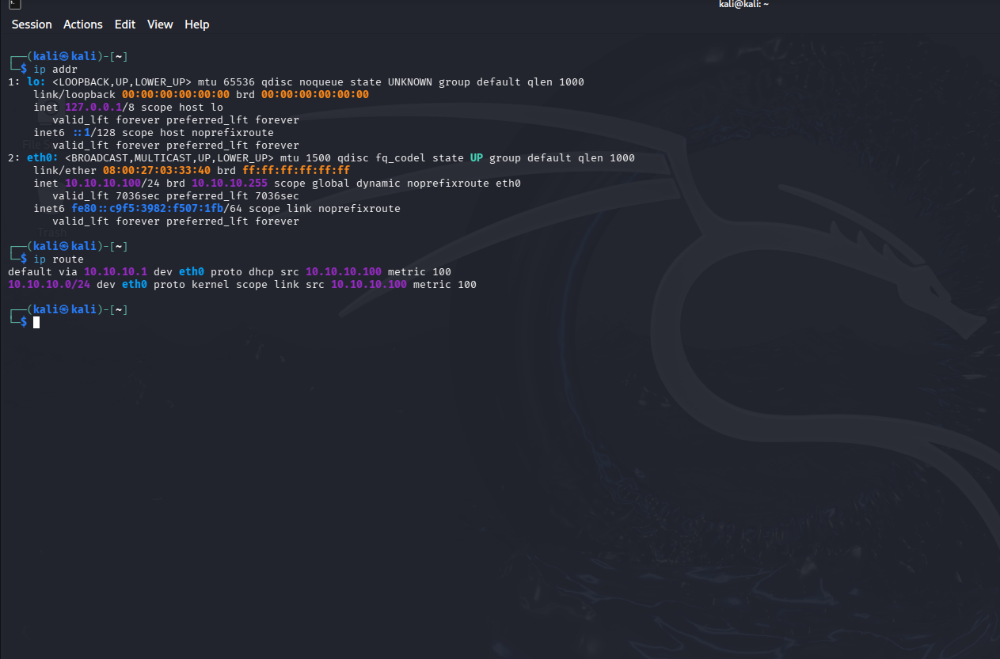

**Figure 1:** Kali Linux IP address and routing configuration.

---

# 2. pfSense Firewall Deployment

## 2.1 pfSense System Dashboard

Following installation, the pfSense web-based management interface was accessed to verify that the firewall was operational.

The dashboard provided visibility into system information, interface status, and firewall functionality.

Successful access to the management interface confirmed that the initial installation and administrative configuration had been completed.

### Evidence

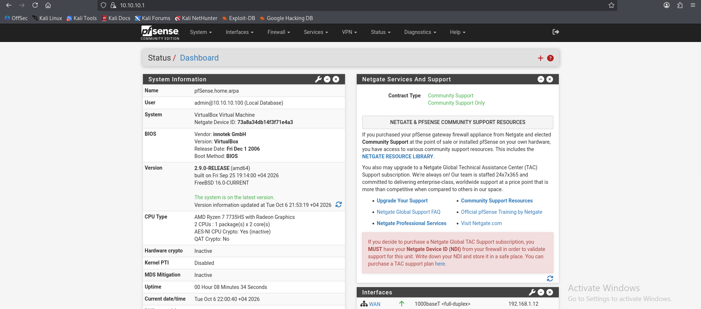

**Figure 2:** pfSense firewall system dashboard.

## 2.2 WAN and LAN Interface Status

The WAN and LAN interfaces were examined to verify their configuration and operational status.

The WAN interface provided connectivity toward the external network, while the LAN interface supported communication with the internal testing environment.

Correct interface assignment was essential to ensure that network traffic followed the intended routing path.

### Evidence

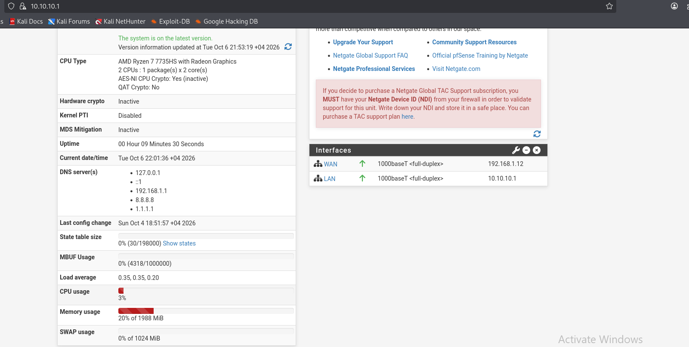

**Figure 3:** pfSense WAN and LAN interface status.

## 2.3 DHCP Lease Verification

The DHCP lease information was reviewed to identify connected clients and verify IP address allocation.

This helped confirm that client systems were receiving network configuration information from the expected network infrastructure.

DHCP verification also assisted with identifying the appropriate source addresses for subsequent firewall testing.

### Evidence

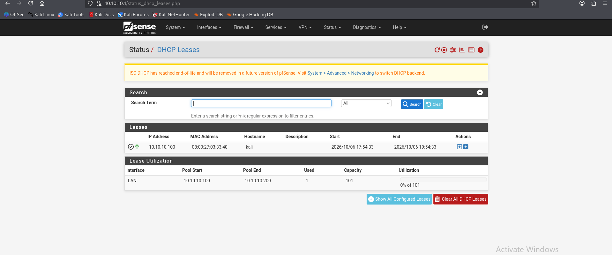

**Figure 4:** DHCP lease assignment and client identification.

---

# 3. Initial Firewall Configuration

## 3.1 Default LAN Firewall Rules

Before implementing additional security restrictions, the existing LAN firewall rules were reviewed.

This established an understanding of the firewall's initial access control configuration.

The review included examining:

- Firewall rule actions.
- Source and destination addresses.
- Protocol selection.
- Rule ordering.
- Permitted network traffic.

Understanding the existing rules was necessary because pfSense evaluates interface firewall rules according to their configured order.

### Evidence

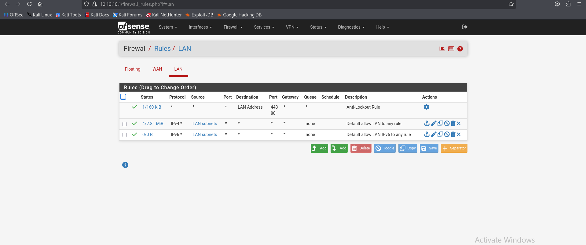

**Figure 5:** Default LAN firewall rules.

## 3.2 Baseline Network Connectivity Verification

Initial connectivity tests were conducted from Kali Linux before implementing restrictive firewall policies.

ICMP requests were used to verify network reachability, while HTTPS connectivity was tested to confirm access to external web resources.

These tests established a baseline against which subsequent firewall restrictions could be evaluated.

### Evidence

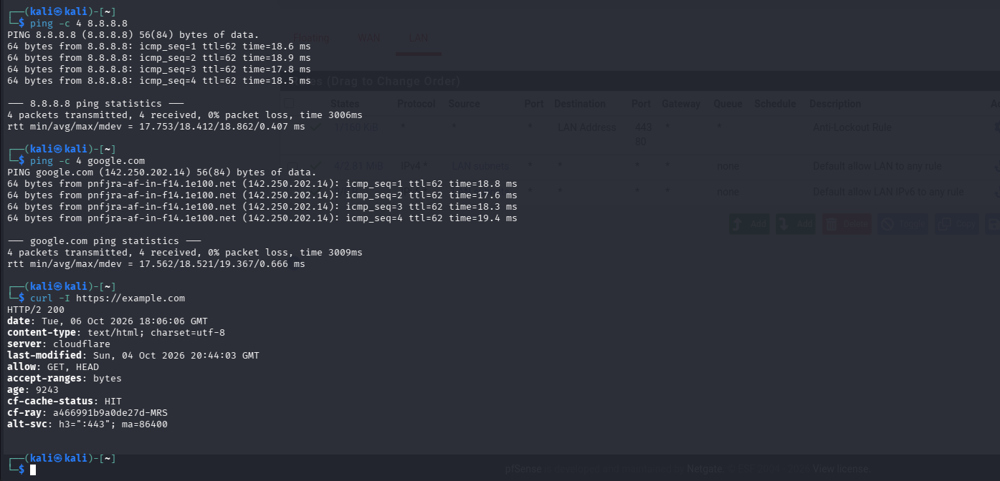

**Figure 6:** ICMP connectivity and HTTPS verification.

---

# 4. ICMP Traffic Filtering

## 4.1 ICMP Blocking Rule Configuration

A firewall rule was configured to restrict ICMP traffic originating from the internal network.

ICMP is commonly used for network diagnostics, including ping requests.

The purpose of this test was to demonstrate how firewall rules can restrict specific protocols without necessarily blocking all network communication.

The rule configuration involved defining the appropriate:

- Firewall action.
- Network interface.
- Protocol.
- Source network.
- Destination.
- Logging settings.

### Evidence

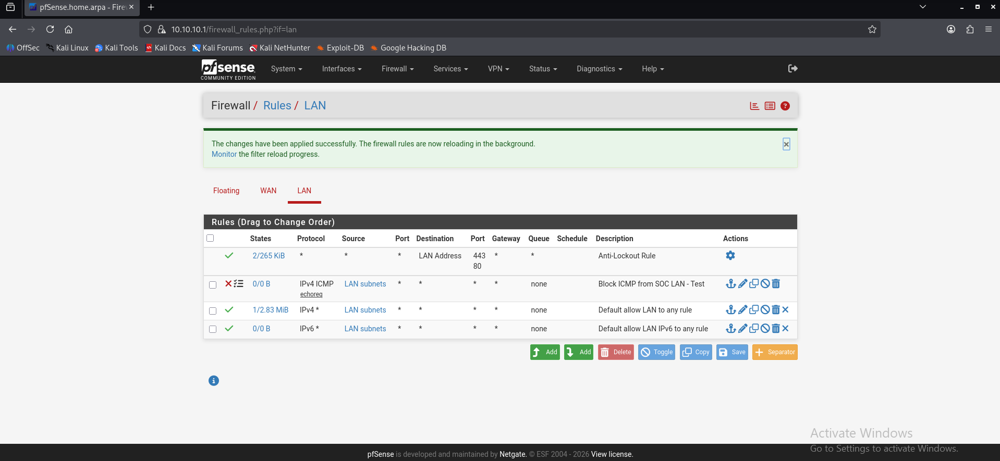

**Figure 7:** ICMP blocking firewall rule configuration.

## 4.2 ICMP Blocking Verification

After applying the firewall rule, connectivity testing was repeated from Kali Linux.

The test demonstrated 100% packet loss for the selected ICMP communication.

This indicated that the ICMP requests were not receiving responses after the firewall restriction was implemented.

The result was evaluated alongside the firewall logs to determine whether the configured policy was responsible for blocking the traffic.

### Evidence

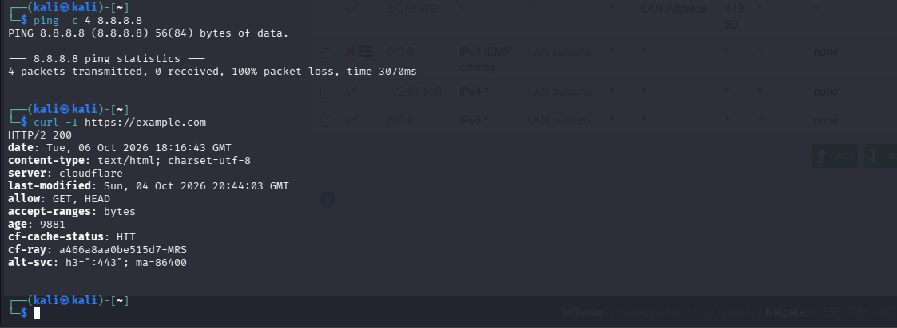

**Figure 8:** ICMP blocking verification showing 100% packet loss.

## 4.3 ICMP Firewall Log Analysis

The pfSense firewall logs were examined to identify events associated with blocked ICMP traffic.

The log entries provided supporting evidence that the firewall was enforcing the configured restriction.

Firewall logging was particularly important because packet loss alone does not conclusively establish that a firewall rule caused the communication failure.

### Evidence

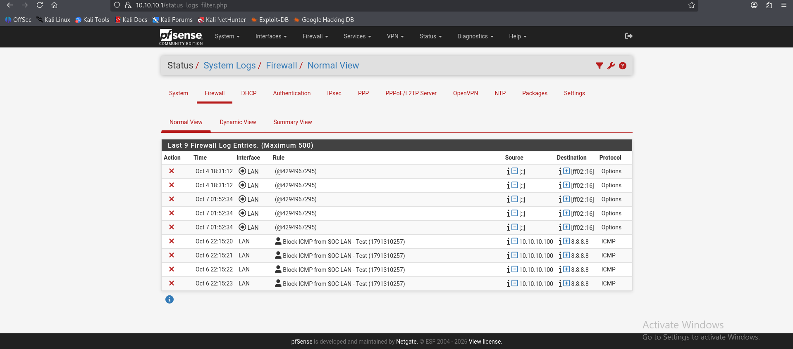

**Figure 9:** Firewall logs showing blocked ICMP traffic.

### Findings

The ICMP testing demonstrated the importance of validating firewall policies through both connectivity testing and log analysis.

The results illustrated how protocol-specific access controls can restrict selected network communications.

---

# 5. DNS Traffic Filtering

## 5.1 Baseline DNS Resolution Testing

DNS functionality was tested before implementing additional restrictions.

DNS is responsible for translating domain names into IP addresses and is essential for many network applications.

Baseline testing was performed to establish whether domain name resolution was functioning correctly.

### Evidence

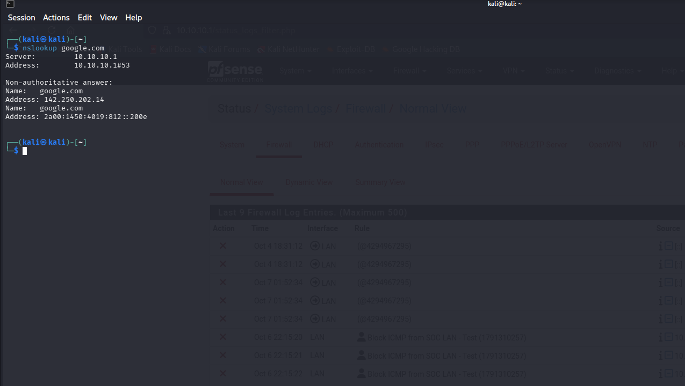

**Figure 10:** DNS resolution testing through pfSense.

## 5.2 DNS Blocking Rule Configuration

A firewall rule was configured to restrict DNS communication using destination port 53.

The objective was to evaluate how firewall policies could control access to domain name resolution services.

The rule was configured to target the selected DNS traffic originating from the internal network.

This demonstrated the use of port-based filtering to restrict network services.

### Evidence

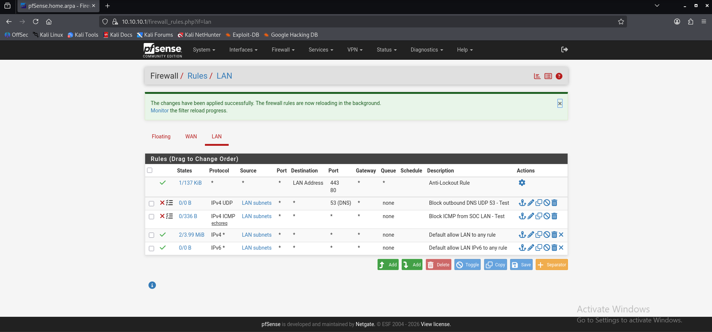

**Figure 11:** DNS port 53 blocking rule.

## 5.3 DNS Filtering Verification

Following the implementation of the DNS restriction, additional testing was conducted from Kali Linux.

The tests evaluated whether domain name resolution was affected by the firewall policy.

This phase demonstrated the operational impact that DNS filtering can have on applications relying on hostname resolution.

### Evidence

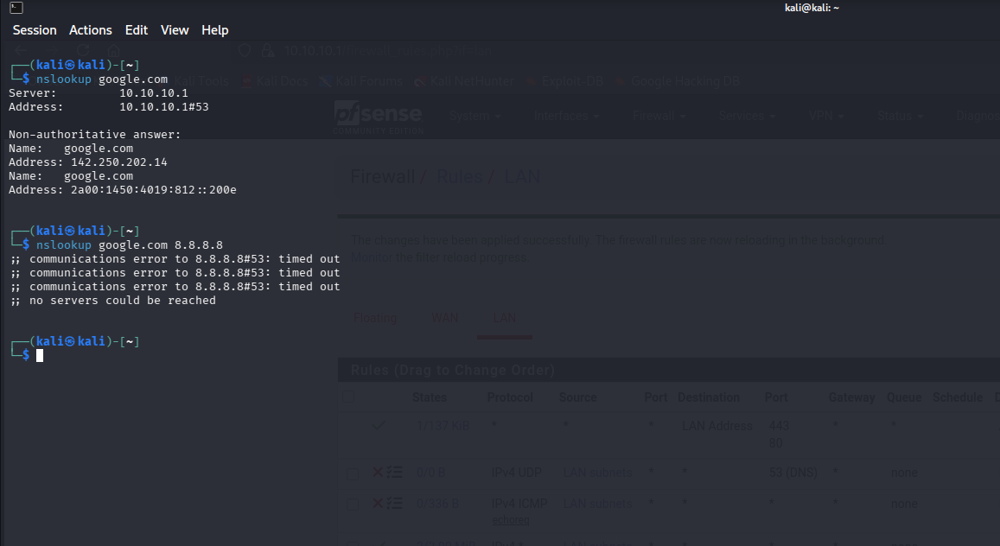

**Figure 12:** DNS filtering and resolution testing.

## 5.4 DNS Firewall Log Analysis

The firewall logs were reviewed to identify blocked DNS requests associated with the configured rule.

The analysis helped verify that the firewall was processing the selected DNS traffic according to the implemented policy.

The logs also demonstrated how firewall monitoring can support troubleshooting and security investigations.

### Evidence

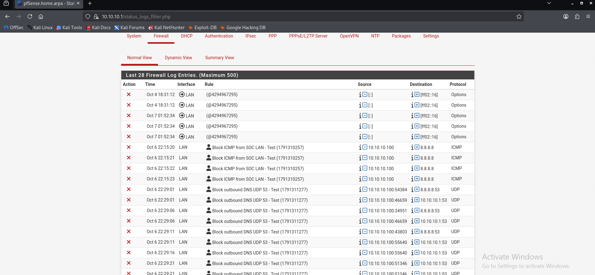

**Figure 13:** Firewall logs showing blocked DNS requests.

## 5.5 DNS Connectivity Restoration

After completing the DNS filtering tests, the restrictive firewall configuration was adjusted.

DNS resolution was tested again to confirm that normal functionality had been restored.

This step demonstrated the importance of validating network connectivity after modifying firewall policies.

### Evidence

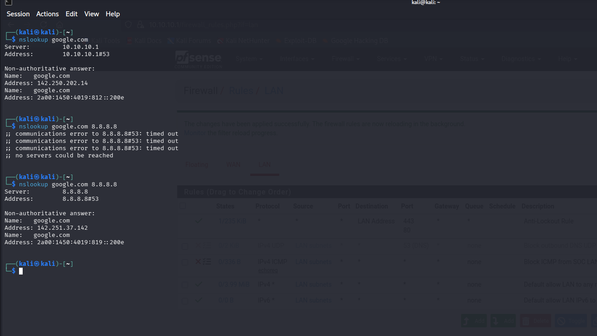

**Figure 14:** DNS resolution restored after firewall testing.

### Findings

The DNS testing demonstrated how port-based firewall restrictions can affect network services.

It also highlighted the importance of reviewing firewall logs and validating connectivity after applying or removing security policies.

---

# 6. Firewall Interface and Policy Verification

## 6.1 Console Interface Configuration

The pfSense console interface was reviewed to verify WAN and LAN configuration.

Console-level verification provided an additional method of confirming network interface assignments independently of the web management interface.

This was particularly useful when investigating network connectivity issues.

### Evidence

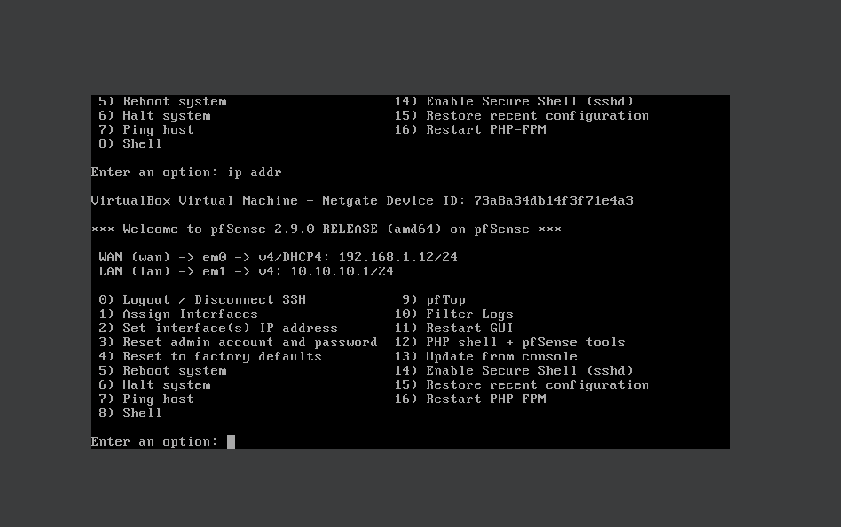

**Figure 15:** pfSense console WAN and LAN configuration.

## 6.2 Additional ICMP Blocking Verification

An additional ICMP connectivity test was conducted from Kali Linux.

This test provided further evidence of the firewall's ability to restrict selected network communication.

The results were used to assess whether the configured ICMP policy was functioning as intended.

### Evidence

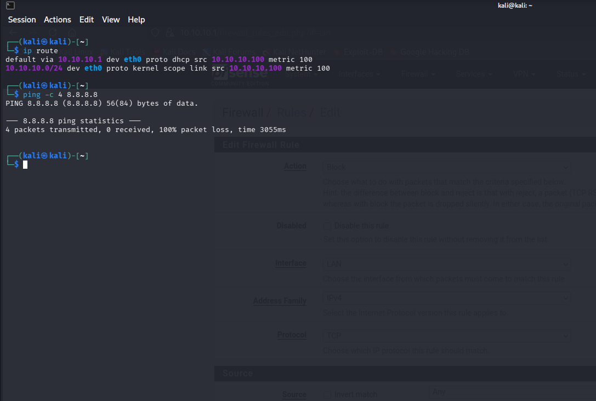

**Figure 16:** ICMP blocking test from Kali Linux.

## 6.3 Firewall Rule Review

The LAN firewall rules were reviewed after implementing and testing the security restrictions.

This review helped verify the overall firewall configuration and the relationship between individual access control policies.

Particular attention was given to the ordering and scope of the configured rules.

### Evidence

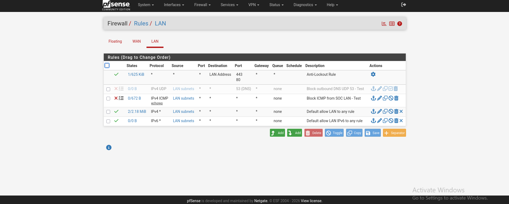

**Figure 17:** LAN firewall rules and access control configuration.

---

# 7. HTTP and HTTPS Traffic Filtering

## 7.1 HTTP Blocking Rule Configuration

A firewall rule was configured to restrict HTTP communication using destination TCP port 80.

HTTP is commonly associated with unencrypted web traffic.

The purpose of this test was to demonstrate how a firewall can restrict a specific application protocol using destination port filtering.

The configuration targeted HTTP traffic while allowing the behavior of other network services to be evaluated separately.

### Evidence

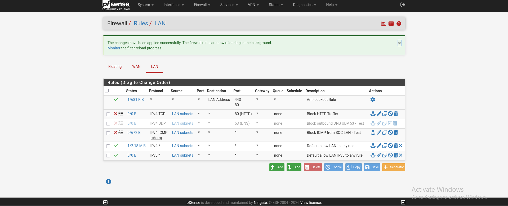

**Figure 18:** HTTP port 80 blocking rule.

## 7.2 HTTP Blocking Verification

Following implementation of the HTTP restriction, connectivity testing was performed from Kali Linux.

The objective was to determine whether HTTP communication was being restricted by the firewall.

The results were compared against the configured rule and corresponding firewall logs.

### Evidence

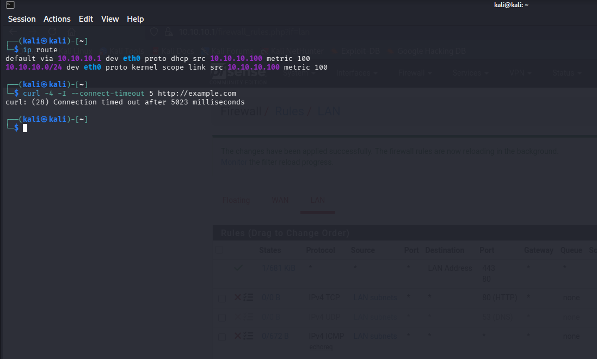

**Figure 19:** HTTP connection blocking verification.

## 7.3 HTTP and HTTPS Filtering Comparison

Additional testing was performed to evaluate the difference between HTTP and HTTPS connectivity.

The tests demonstrated the distinction between filtering traffic associated with TCP port 80 and traffic associated with TCP port 443.

This provided practical insight into protocol-specific firewall filtering.

Blocking HTTP does not automatically block HTTPS because the protocols typically use different destination ports.

### Evidence

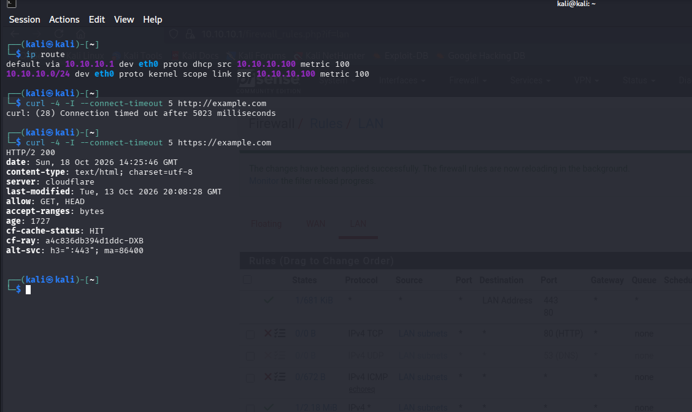

**Figure 20:** HTTP blocking and HTTPS connectivity verification.

## 7.4 HTTP Firewall Log Analysis

The pfSense firewall logs were examined to identify blocked HTTP traffic.

The logs provided evidence of the firewall processing traffic according to the configured HTTP restriction.

This demonstrated the importance of combining firewall policy configuration with monitoring and verification.

### Evidence

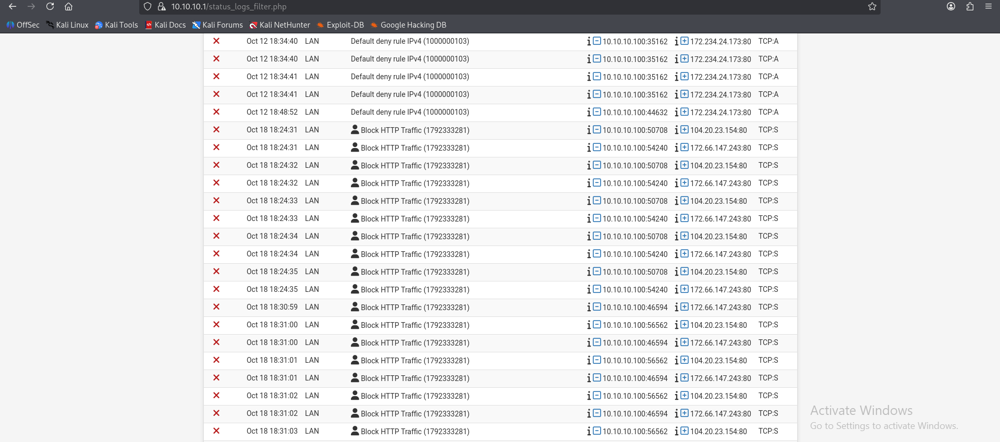

**Figure 21:** pfSense firewall logs showing blocked HTTP traffic.

## 7.5 HTTP Connectivity Restoration

Following completion of the HTTP filtering tests, the restrictive rule was disabled or adjusted.

HTTP connectivity was subsequently tested to verify that communication had been restored.

This final validation demonstrated the importance of confirming expected network behavior after modifying firewall policies.

### Evidence

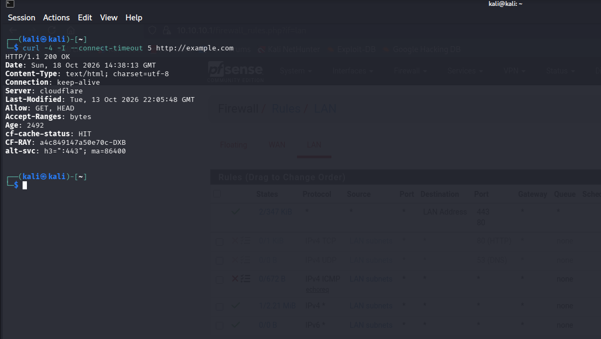

**Figure 22:** HTTP connectivity restored after disabling the firewall rule.

### Findings

The HTTP and HTTPS testing demonstrated the effectiveness of protocol-specific firewall filtering.

The results also highlighted the importance of understanding destination ports, rule ordering, and the relationship between network services.

---

# 8. Security Testing Summary

The project involved multiple stages of firewall configuration and validation.

| Test | Objective | Observed Result |
|------|-----------|-----------------|
| Initial network connectivity | Establish baseline connectivity | Connectivity verified |
| ICMP filtering | Restrict selected ICMP traffic | ICMP communication blocked |
| ICMP log analysis | Verify firewall enforcement | Blocked traffic recorded |
| DNS filtering | Restrict selected DNS traffic | DNS filtering behavior observed |
| DNS log analysis | Investigate blocked DNS requests | Relevant firewall events recorded |
| DNS restoration | Restore name resolution | DNS functionality restored |
| HTTP filtering | Restrict HTTP communication | HTTP traffic blocked |
| HTTPS verification | Evaluate separate HTTPS connectivity | HTTPS connectivity tested |
| HTTP log analysis | Verify HTTP filtering | Blocked HTTP traffic recorded |
| HTTP restoration | Restore HTTP communication | Connectivity restored |

The tests demonstrated how firewall policies can be implemented, validated, monitored, and modified to achieve specific network security objectives.

---

# 9. Security Principles Demonstrated

## 9.1 Network Access Control

The project demonstrated how firewall policies can regulate communication between network systems.

Access control rules were implemented to permit or restrict traffic according to predefined conditions.

## 9.2 Stateful Packet Filtering

pfSense provides stateful firewall functionality, allowing network communication to be evaluated using packet information and connection states.

The project focused on practical rule configuration and traffic filtering.

## 9.3 Protocol-Based Filtering

ICMP, DNS, and HTTP testing demonstrated how firewall rules can target specific protocols and services.

This provided practical experience in configuring network restrictions.

## 9.4 Firewall Logging and Monitoring

Firewall logs were used to investigate blocked traffic and verify rule enforcement.

The analysis demonstrated the importance of monitoring network security controls.

## 9.5 Security Policy Validation

Connectivity testing was performed before and after implementing firewall restrictions.

This approach helped evaluate whether the configured security policies produced the intended results.

## 9.6 Network Troubleshooting

The project involved identifying and resolving network connectivity issues associated with interface configuration and firewall rules.

This strengthened practical troubleshooting skills.

---

# 10. Challenges Encountered

## 10.1 Initial Network Connectivity Issues

During the initial setup, connectivity issues were encountered between the virtual machines.

Network interface settings and routing configurations were reviewed to identify the cause.

Connectivity was subsequently restored through configuration adjustments.

## 10.2 Firewall Rule Configuration

Configuring firewall rules required careful consideration of source addresses, destination addresses, protocols, and rule ordering.

Incorrectly configured rules could result in unintended network restrictions.

## 10.3 Identifying Blocked Traffic

Connectivity failures alone were insufficient to conclusively determine whether a firewall rule was responsible.

Firewall logs were therefore examined to correlate blocked traffic with the implemented policies.

## 10.4 Restoring Network Connectivity

Following security testing, restrictive firewall policies needed to be adjusted to restore normal communication.

Additional connectivity tests were performed to verify successful restoration.

---

# 11. Key Findings

The project produced several important findings.

### Finding 1: Firewall Rules Effectively Control Network Traffic

Protocol-specific firewall rules successfully demonstrated the ability to restrict selected network communications.

### Finding 2: Firewall Logs Are Essential for Verification

Firewall logs provided evidence of blocked traffic and supported the investigation of connectivity failures.

### Finding 3: Rule Configuration Requires Careful Planning

The effectiveness of firewall policies depends on correctly configured source addresses, destinations, protocols, and rule ordering.

### Finding 4: Different Network Services Require Different Policies

ICMP, DNS, HTTP, and HTTPS traffic have different characteristics and may require separate firewall rules.

### Finding 5: Security Testing Must Include Restoration

Validating network functionality after modifying firewall policies is important for maintaining operational availability.

---

# 12. Limitations

The project was conducted within a controlled virtualized environment.

As a result, several limitations should be considered:

- The network architecture was smaller than a typical enterprise environment.
- Testing focused primarily on ICMP, DNS, HTTP, and HTTPS communication.
- Firewall policies were evaluated using selected network traffic.
- Advanced intrusion detection and prevention systems were not implemented.
- VLAN-based network segmentation was not configured.
- Centralized SIEM integration was outside the scope of this implementation.
- Performance testing under enterprise-scale network loads was not conducted.

These limitations provide opportunities for future project development.

---

# 13. Future Improvements

Potential improvements to the project include:

### 13.1 VLAN-Based Network Segmentation

Implement separate VLANs to isolate different network segments and enforce inter-VLAN firewall policies.

### 13.2 Intrusion Detection and Prevention

Deploy Suricata or Snort to provide additional network threat detection capabilities.

### 13.3 SIEM Integration

Forward pfSense firewall logs to Wazuh for centralized monitoring, event correlation, and security alerting.

### 13.4 pfBlockerNG Integration

Implement pfBlockerNG to investigate DNS-based filtering and IP reputation-based blocking.

### 13.5 Advanced Firewall Policies

Develop additional firewall policies covering:

- SSH access restrictions.
- Administrative interface protection.
- Outbound traffic filtering.
- Network service isolation.
- Application-specific access controls.

### 13.6 Network Security Monitoring

Expand the testing environment to include additional network traffic analysis and monitoring tools.

---

# 14. Skills Demonstrated

This project demonstrates practical experience in:

**Network Security**
- Firewall configuration
- Network access control
- Protocol filtering
- Network troubleshooting

**Firewall Administration**
- pfSense deployment
- WAN and LAN configuration
- Firewall rule management
- Firewall log analysis

**Network Testing**
- ICMP connectivity testing
- DNS resolution testing
- HTTP and HTTPS connectivity testing
- Traffic filtering verification

**Virtualization**
- Oracle VirtualBox
- Virtual network configuration
- Virtual machine connectivity

**Security Operations**
- Network traffic monitoring
- Security policy validation
- Log investigation
- Troubleshooting blocked connections

---

# 15. Conclusion

This project successfully demonstrated the deployment, configuration, and evaluation of a pfSense firewall within a virtualized network environment.

Through the implementation of ICMP, DNS, and HTTP filtering policies, the project provided practical experience in controlling network communication and validating firewall security rules.

The use of Kali Linux for connectivity testing and pfSense firewall logs for traffic analysis enabled the effectiveness of the implemented policies to be assessed.

The project also emphasized the importance of accurate firewall rule configuration, continuous monitoring, and systematic troubleshooting.

Overall, the implementation strengthened practical knowledge of network security administration, firewall policy management, and security monitoring.

These skills are directly relevant to cybersecurity roles involving network defense, security operations, and infrastructure protection.

---

# Disclaimer

This project was conducted within a controlled virtualized environment for educational and cybersecurity training purposes.

All firewall configurations and network tests were performed on systems within the authorized testing environment.

No unauthorized third-party systems were targeted.

---

## Author

**Muhammad Mubashir Noman**

BS Cyber Security

Cybersecurity | Network Security | Security Operations
